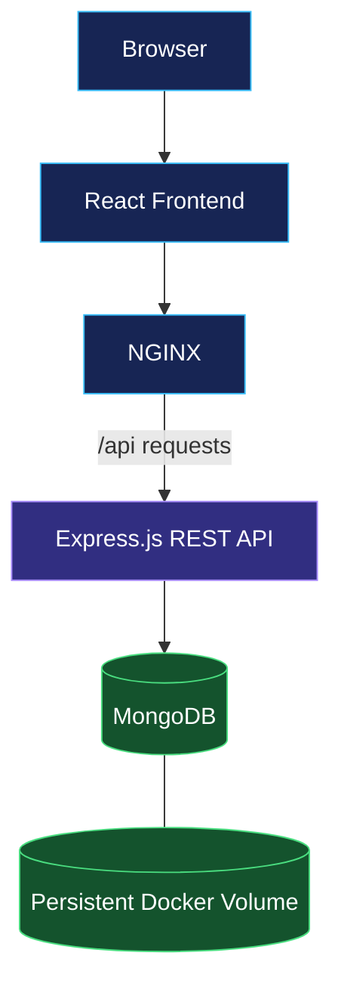

# Expense Tracker

<p align="center">
  
  
  
  
  
</p>

<p align="center">
  A full-stack MERN expense management application containerized with Docker Compose, featuring a modern interface, expense analytics, and a REST API.
</p>

<p align="center">
  <a href="https://github.com/tanahmeeedsx/expense-tracker">Repository</a> ·
  <a href="#features">Features</a> ·
  <a href="#getting-started">Getting Started</a> ·
  <a href="#api-endpoints">API</a>
</p>

---

## Overview

Expense Tracker is a full-stack application for managing daily expenses through a modern, cyber-inspired interface. It combines React, Express.js, and MongoDB in a containerized environment, with NGINX serving the frontend and proxying API requests to the backend.

## Features

- **Expense Management** — Add, edit, and delete expenses.
- **Expense Analytics** — Summary cards and category breakdowns.
- **Search & Filters** — Search by title, filter by category, and select date ranges.
- **CSV Export** — Export filtered expenses to a CSV file.
- **Demo Data** — Seed sample expenses for testing.
- **Containerized Architecture** — Run the frontend, backend, and database with one command.
- **Persistent Storage** — Preserve database data using a Docker volume.

## Architecture



## Tech Stack

| Technology | Purpose |
|---|---|
| React + Vite | Frontend and UI |
| Node.js + Express.js | Backend REST API |
| MongoDB | Database |
| NGINX | Static file serving and API reverse proxy |
| Docker | Containerization |
| Docker Compose | Multi-container orchestration |

## Getting Started

### Prerequisites

- Docker Engine
- Docker Compose v2 or later

### 1. Clone the repository

```bash
git clone https://github.com/tanahmeeedsx/expense-tracker.git
cd expense-tracker
```

### 2. Configure environment variables

Review `.env.example` and configure the variables required by `docker-compose.yml` and the backend.

### 3. Build and start the application

```bash
docker compose up -d --build
```

### 4. Open the application

If port `80` is available:

```text
http://localhost
```

If port `80` is already occupied, configure the frontend port mapping in `docker-compose.yml`, for example:

```yaml
ports:
  - "8080:80"
```

Then open `http://localhost:8080`.

### 5. Verify the containers

```bash
docker compose ps
```

View application logs:

```bash
docker compose logs -f
```

Stop the application:

```bash
docker compose down
```

To remove the database volume and its stored data:

```bash
docker compose down -v
```

**Warning:** The last command permanently removes the Compose-managed database volume.

## API Endpoints

The API is accessible through the frontend's NGINX proxy.

| Method | Endpoint | Description |
|---|---|---|
| GET | `/api/health` | Health check |
| GET | `/api/expenses` | Retrieve expenses |
| POST | `/api/expenses` | Create an expense |
| POST | `/api/expenses/seed` | Seed demo data |

### Test the API

Check application health:

```bash
curl http://localhost/api/health
```

Retrieve expenses:

```bash
curl http://localhost/api/expenses
```

Create an expense:

```bash
curl -X POST http://localhost/api/expenses \
  -H "Content-Type: application/json" \
  -d '{"title":"Coffee","amount":4.5,"category":"Food","note":"Morning coffee"}'
```

If using port `8080`, replace `localhost` with `localhost:8080` in these URLs.

## Project Structure

```text
expense-tracker/
├── backend/
│   ├── src/
│   │   ├── models/
│   │   ├── routes/
│   │   └── server.js
│   └── Dockerfile
├── frontend/
│   ├── nginx/
│   │   └── default.conf
│   ├── src/
│   └── Dockerfile
├── .env.example
├── .gitignore
├── docker-compose.yml
└── README.md
```

## What I Learned

- Building and containerizing a full-stack MERN application.
- Orchestrating multiple services with Docker Compose.
- Connecting a Node.js backend to MongoDB.
- Configuring NGINX as a reverse proxy.
- Managing persistent database storage and service networking.
- Troubleshooting container startup and host port conflicts.

## Future Improvements

- Automated CI/CD with GitHub Actions.
- HTTPS and production deployment on AWS.
- Authentication and authorization.
- Centralized logging, monitoring, and database backups.

---

<p align="center">
  Built by <a href="https://github.com/tanahmeeedsx">Tanjim Ahmed</a>
</p>

<p align="center">
  <a href="https://github.com/tanahmeeedsx/expense-tracker">
    
  </a>
</p>
