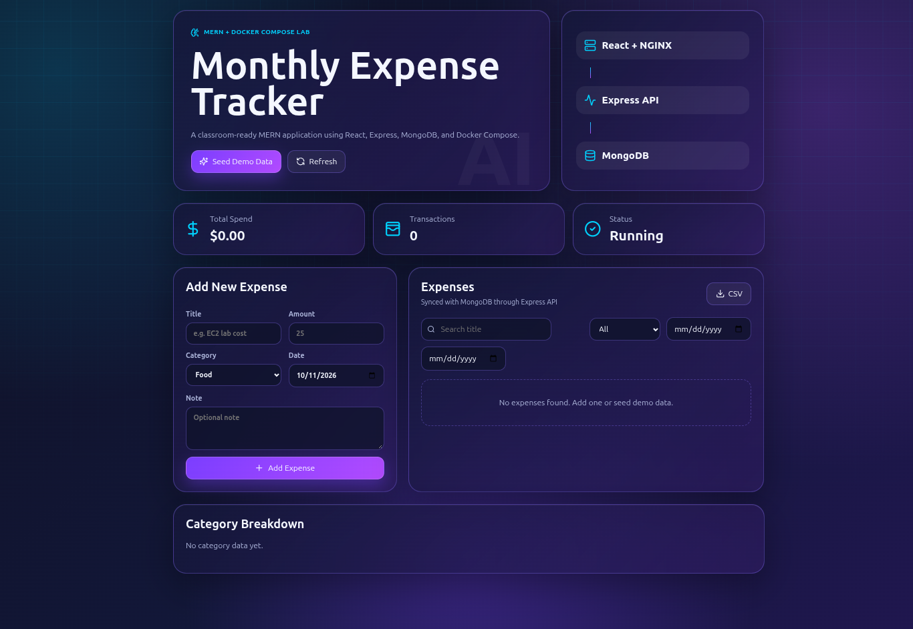

# 🚀 Expense Tracker — Cloud Deployment with Docker & AWS

<p align="center">
  
  
  
  
</p>

<p align="center">
  
  
  
  
</p>

<p align="center">
  A containerized expense tracking application deployed on AWS EC2 using Docker Compose, with MongoDB persistence and automated database backups to Amazon S3.
</p>

<p align="center">
  <a href="http://18.142.228.205/"><strong>🌐 Live Demo</strong></a>
  &nbsp; • &nbsp;
  <a href="https://github.com/tanahmeeedsx/expense-tracker"><strong>💻 GitHub Repository</strong></a>
</p>

---

## 📸 Application Preview



## ✨ Features

- Add and view expenses.
- Store expense data in MongoDB.
- Run the frontend, backend, and database using Docker Compose.
- Persist database data using Docker volumes.
- Use separate Docker networks for application components.
- Apply container hardening, health checks, and environment-based configuration.
- Deploy the application on AWS EC2.
- Back up MongoDB to Amazon S3.
- Schedule automated backups using Linux cron.
- Test database recovery using a separate restore database.

## 🏗️ Architecture

The application runs as three Docker containers connected through Docker Compose.

```text
                      Users
                        |
                        v
                 Frontend (NGINX)
                        |
                        v
                 Backend (Node.js)
                        |
                        v
                    MongoDB
                        |
                        v
                 Docker Volume
```

### How It Works

- **Frontend:** React application served by NGINX.
- **Backend:** Node.js and Express handle API requests.
- **Database:** MongoDB stores expense records.
- **Docker Compose:** Manages the application containers, networks, and volumes.
- **AWS EC2:** Hosts the deployed application.
- **Amazon S3:** Stores database backup archives.

### Database Backup Architecture

```text
              MongoDB Container
                      |
                      v
                  mongodump
                      |
                      v
              Compressed Archive
                      |
                      v
               AWS CLI + IAM Role
                      |
                      v
                Amazon S3
                      |
                      v
            Restore and Verification
```

The backup script creates a compressed MongoDB archive and uploads it to a private S3 bucket using the EC2 IAM role.

## 🛠️ Tech Stack

| Category | Technologies |
|---|---|
| Frontend | React |
| Backend | Node.js, Express |
| Database | MongoDB 7 |
| Web Server | NGINX |
| Containerization | Docker, Docker Compose |
| Cloud Platform | AWS |
| Infrastructure | EC2, S3, IAM |
| Automation | AWS CLI, Bash, Linux cron |
| Operating System | Ubuntu |

## 💻 How to Run Locally

### Prerequisites

Install the following tools before starting:

- Git
- Docker
- Docker Compose

### 1. Clone the Repository

```bash
git clone https://github.com/tanahmeeedsx/expense-tracker.git
cd expense-tracker
```

### 2. Configure Environment Variables

Create your local environment file:

```bash
cp .env.example .env
nano .env
```

Configure the required variables according to `.env.example`. For local access, use settings such as:

```env
HTTP_PORT=8080
CORS_ORIGIN=http://localhost:8080
```

Keep the database credentials and other required variables configured correctly. Use strong passwords and never commit your `.env` file to GitHub.

### 3. Build and Start the Application

```bash
docker compose up -d --build
```

### 4. Verify the Containers

```bash
docker compose ps
```

To view application logs:

```bash
docker compose logs -f
```

### 5. Open the Application

Visit:

**http://localhost:8080**

Check the backend health endpoint:

```bash
curl http://localhost:8080/api/health
```

### 6. Stop the Application

```bash
docker compose down
```

This normally preserves named volumes, so MongoDB data remains available when you restart the application. Avoid `docker compose down -v` unless you intentionally want to delete the associated volumes.

## ☁️ How to Run on AWS EC2

### 1. Launch an EC2 Instance

Create an Ubuntu EC2 instance and configure its security group:

- **HTTP — Port 80:** Allow public web access.
- **HTTPS — Port 443:** Use when HTTPS is configured.
- **SSH — Port 22:** Restrict access to your own IP address.

Install Docker Engine and the Docker Compose plugin if they are not already installed.

### 2. Connect to EC2

From your local terminal:

```bash
ssh -i ~/.ssh/your-key.pem ubuntu@YOUR_EC2_PUBLIC_IP
```

Replace the key filename and public IP with your actual values.

### 3. Clone the Project

Run these commands on the EC2 instance:

```bash
git clone https://github.com/tanahmeeedsx/expense-tracker.git
cd expense-tracker
```

### 4. Configure the Environment

```bash
cp .env.example .env
nano .env
```

Set the required database credentials, HTTP port, public application origin, and backup configuration. Do not expose or commit `.env`.

### 5. Build and Start the Containers

```bash
sudo docker compose up -d --build
```

Verify the services:

```bash
sudo docker compose ps
```

Check the API health endpoint:

```bash
curl http://localhost/api/health
```

### 6. Access the Deployed Application

Open your EC2 public IP in a browser:

```text
http://YOUR_EC2_PUBLIC_IP
```

Current deployment:

**[Open Expense Tracker Live Demo](http://18.142.228.205/)**

**Security note:** The current public demo uses HTTP and does not yet include application authentication. Avoid entering sensitive financial information. HTTPS and authentication remain future improvements.

## 🗄️ How to Back Up and Restore MongoDB

The project includes scripts for creating MongoDB backups and restoring database data. Amazon S3 stores the backup archives, while an EC2 IAM role authorizes the backup process.

### 1. Configure AWS Backup Access

Make sure the EC2 instance has an IAM role with the required least-privilege S3 permissions.

Configure the backup bucket name and AWS region in `.env`.

### 2. Create a MongoDB Backup

From the project directory on EC2:

```bash
sudo ./scripts/backup.sh
```

The script creates a compressed MongoDB archive and uploads it to the configured S3 bucket.

### 3. Verify the Backup in S3

```bash
aws s3 ls s3://YOUR_BACKUP_BUCKET/mongodb/expense_tracker/ --recursive
```

Replace `YOUR_BACKUP_BUCKET` with your actual bucket name.

### 4. Schedule Automatic Backups

Linux cron can run the backup script automatically on a schedule.

The configured schedule is **20:00 UTC**, equivalent to **2:00 AM the following day in Bangladesh**.

Check the backup log:

```bash
sudo tail -n 50 /var/log/expense-tracker-backup.log
```

### 5. Restore and Verify a Backup

A backup is useful only if its data can be recovered. Before restoring, check the behavior of `scripts/restore.sh`. If it uses `--drop` against the configured live database, existing data in affected collections can be replaced.

For a safer restore test:

1. Download a backup archive from S3.
2. Restore it into a separate test database.
3. Verify the collections and document count.
4. Confirm that the live database remains unchanged.

Example for an archive that has already been downloaded to a compatible MongoDB container:

```bash
docker exec -i expense-restore-test mongorestore \
  --gzip \
  --archive \
  --nsFrom="expense_tracker.*" \
  --nsTo="expense_tracker_backup_verify.*" \
  < /tmp/expense-tracker-restore-test.archive.gz
```

This example assumes the archive is a compatible `mongodump` archive and that the target MongoDB server is accessible with the necessary permissions. Configure authentication and the database connection as required.

**Important:** Do not run a destructive restore against the live database unless that is explicitly intended and you have a recovery plan.

## 🔌 API Endpoints

| Method | Endpoint | Description |
|---|---|---|
| GET | `/api/health` | Check backend health |
| GET | `/api/expenses` | Retrieve expenses |
| POST | `/api/expenses` | Create an expense |

## 🧩 Challenges and Solutions

### 1. Container Networking

**Challenge:** Connecting the frontend, backend, and database while limiting unnecessary exposure.

**Solution:** Used Docker Compose networks to control service communication and kept MongoDB off the public host ports.

### 2. Persistent Database Storage

**Challenge:** Ensuring that database records survive container recreation.

**Solution:** Used a named Docker volume for MongoDB data persistence.

### 3. AWS Permissions

**Challenge:** Uploading backups to S3 without storing AWS access keys in the project.

**Solution:** Configured an EC2 IAM role with the required S3 permissions and used AWS CLI for backup operations.

### 4. Backup Reliability

**Challenge:** Confirming that uploaded backups could actually recover the database.

**Solution:** Restored a backup into a separate test database and verified the recovered records without modifying the live database.

## 📚 What I Learned

- Building and managing multi-container applications with Docker Compose.
- Using Docker networks, persistent volumes, and health checks.
- Applying container security controls.
- Deploying applications on AWS EC2.
- Managing cloud permissions with IAM roles.
- Automating MongoDB backups to Amazon S3.
- Scheduling recurring tasks using Linux cron.
- Testing database recovery instead of relying only on successful backup uploads.

## 🔮 Future Improvements

- Configure HTTPS with a domain and TLS certificates.
- Implement user authentication and authorization.
- Add a CI/CD pipeline for automated testing and deployment.
- Add application monitoring, centralized logging, and alerts.
- Automate backup retention and periodic restore verification.
- Add expense reports, charts, and improved filtering.
- Expand automated tests for the API and deployment configuration.

---

## 📌 Project Status

**Deployed on AWS EC2** with Docker Compose, persistent MongoDB storage, and automated S3 backup support.

HTTPS and application authentication are planned improvements.

## 👨‍💻 Author

**Tanjim Ahmed**

- GitHub: [@tanahmeeedsx](https://github.com/tanahmeeedsx)
- LinkedIn: [Tanjim Ahmed](https://www.linkedin.com/in/tanahmedd/)

