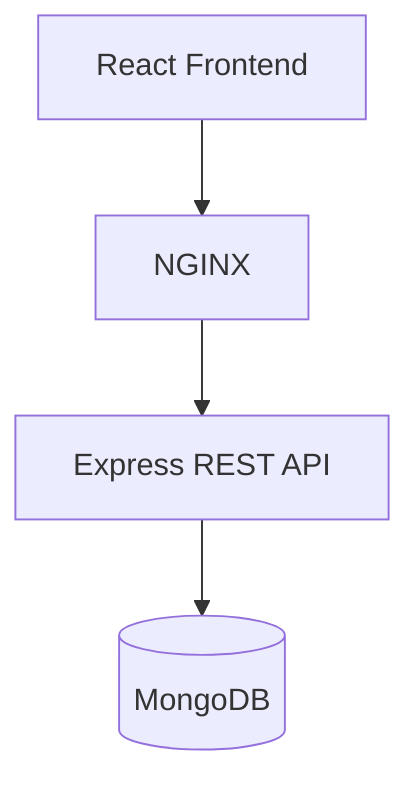

# Expense Tracker

<p align="center">
  
  
  
  
  
  
</p>

<p align="center">
  A full-stack expense tracking application built with the MERN stack and Docker Compose.
</p>

## Application Preview

<p align="center">
  
</p>

## Overview

Expense Tracker is a full-stack web application for managing daily expenses through a clean interface. It uses a React frontend, an Express REST API, and MongoDB for persistent data storage. Docker Compose runs the application services together.

## Features

- Add, edit, and delete expenses
- Search expenses by title
- Filter expenses by category and date range
- View expense summaries and category breakdowns
- Export expenses to CSV
- Seed demo expense data
- Persist data using a MongoDB volume
- Run frontend, backend, and database services with Docker Compose

## Architecture



## Tech Stack

| Technology | Purpose |
|---|---|
| React + Vite | Frontend application |
| Node.js | Backend runtime |
| Express.js | REST API |
| MongoDB | Database |
| NGINX | Frontend serving and API reverse proxy |
| Docker | Application containerization |
| Docker Compose | Multi-container orchestration |

## Getting Started

### Prerequisites

- Git
- Docker Engine
- Docker Compose

### 1. Clone the repository

```bash
git clone https://github.com/tanahmeeedsx/expense-tracker.git
cd expense-tracker
```

### 2. Configure and start the application

```bash
cp .env.example .env        # set passwords; use HTTP_PORT=8080 for local testing
docker compose up -d --build
```

### 3. Open the application

Visit:

**http://localhost:8080** (when `HTTP_PORT=8080` in `.env`; on EC2 use port `80`)

### Stop the application

```bash
docker compose down
```

The MongoDB data volume is retained when you stop the application this way. Avoid `docker compose down -v` if you want to preserve your stored data.

## Deployment (AWS EC2 + S3 backup + Docker Scout)

See [DEPLOYMENT.md](./DEPLOYMENT.md) for the full step-by-step guide.

## API Endpoints

| Method | Endpoint | Description |
|---|---|---|
| GET | `/api/health` | Check API health |
| GET | `/api/expenses` | Retrieve expenses |
| POST | `/api/expenses` | Create an expense |
| POST | `/api/expenses/seed` | Add demo expense data |

## Project Structure

```text
expense-tracker/
├── backend/
│   ├── src/
│   │   ├── models/
│   │   │   └── Expense.js
│   │   ├── routes/
│   │   │   └── expenses.js
│   │   └── server.js
│   ├── Dockerfile
│   └── package.json
├── frontend/
│   ├── nginx/
│   │   └── default.conf
│   ├── src/
│   │   ├── main.jsx
│   │   └── styles.css
│   ├── Dockerfile
│   ├── index.html
│   └── package.json
├── screenshots/
│   └── expense-tracker.png
├── docker-compose.yml
└── README.md
```

## What I Learned

- Building a full-stack application with React and Express
- Creating REST API endpoints
- Connecting a backend to MongoDB
- Containerizing services with Docker
- Configuring NGINX as a reverse proxy
- Running multi-container applications with Docker Compose

## Future Improvements

- User authentication
- Expense charts and reports
- Monthly budgets
- Cloud deployment and CI/CD

---

<p align="center">
  Built to practice full-stack development, REST APIs, and Docker-based deployment.
</p>

<p align="center">
  <a href="https://github.com/tanahmeeedsx/expense-tracker">View Repository</a>
</p>
