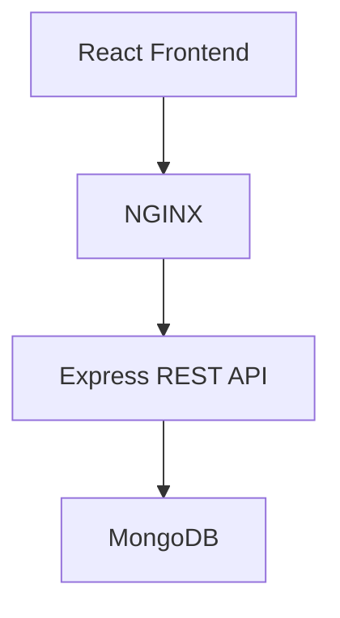

# Expense Tracker

A full-stack expense tracking application built with the MERN stack and Docker Compose.

<p align="center">
  
</p>

## Overview

Expense Tracker helps users manage daily expenses through a clean interface, with expense records stored in MongoDB and a REST API powered by Express.js.

## Features

- Add, edit, and delete expenses
- Search expenses by title
- Filter by category and date range
- View expense summaries and category breakdowns
- Export expenses to CSV
- Seed demo expense data
- Persist data with MongoDB
- Run the full application using Docker Compose

## Architecture



## Tech Stack

| Technology | Purpose |
|---|---|
| React + Vite | Frontend |
| Node.js | Backend runtime |
| Express.js | REST API |
| MongoDB | Database |
| NGINX | Frontend serving and API reverse proxy |
| Docker Compose | Container orchestration |

## Getting Started

### Prerequisites

- Docker
- Docker Compose

### Run Locally

Clone the repository:

```bash
git clone https://github.com/tanahmeeedsx/expense-tracker.git
cd expense-tracker
```

Create your environment file from the example, if required:

```bash
cp .env.example .env
```

Start the application:

```bash
docker compose up -d --build
```

Open the application in your browser:

- `http://localhost:8080` if your frontend port mapping is `8080:80`
- Otherwise, use the host port configured in `docker-compose.yml`

To stop the application:

```bash
docker compose down
```

To stop the application without removing the MongoDB data volume, use the command above. Avoid `docker compose down -v` unless you intentionally want to remove the persisted volume.

## API Endpoints

| Method | Endpoint | Description |
|---|---|---|
| GET | `/api/health` | Check API health |
| GET | `/api/expenses` | Retrieve expenses |
| POST | `/api/expenses` | Create an expense |
| POST | `/api/expenses/seed` | Add demo data |

## Project Structure

```text
expense-tracker/
├── backend/
│   ├── src/
│   │   ├── models/
│   │   ├── routes/
│   │   └── server.js
│   ├── Dockerfile
│   └── package.json
├── frontend/
│   ├── src/
│   ├── nginx/
│   ├── Dockerfile
│   ├── index.html
│   └── package.json
├── screenshots/
├── docker-compose.yml
└── README.md
```

## What I Practiced

- Building a full-stack application with React and Express
- Designing REST API endpoints
- Connecting an application to MongoDB
- Containerizing frontend and backend services
- Using NGINX as a reverse proxy
- Running multiple services with Docker Compose

## Future Improvements

- User authentication
- Expense charts and reports
- Monthly budgets
- Cloud deployment and CI/CD

---

**Built as a hands-on project to practice full-stack development and containerization.**

[GitHub Repository](https://github.com/tanahmeeedsx/expense-tracker)
